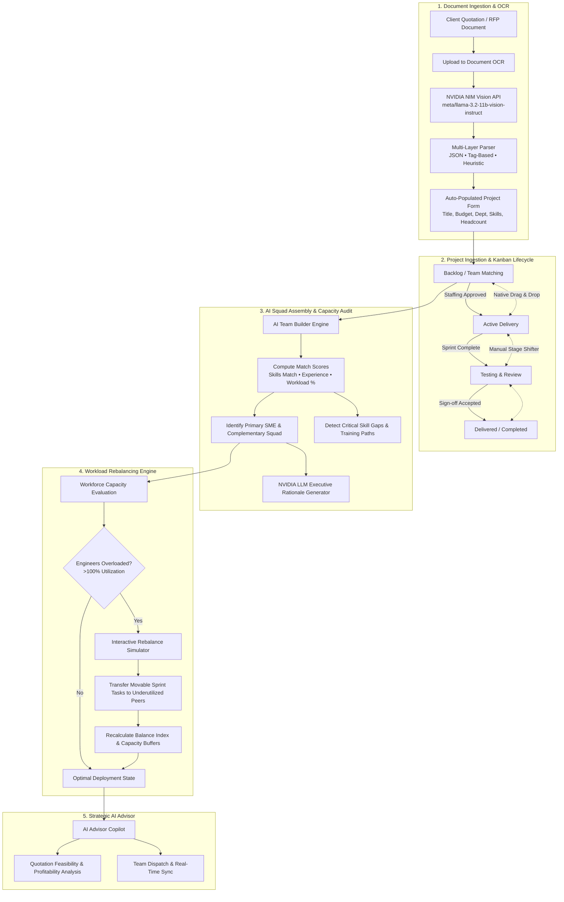
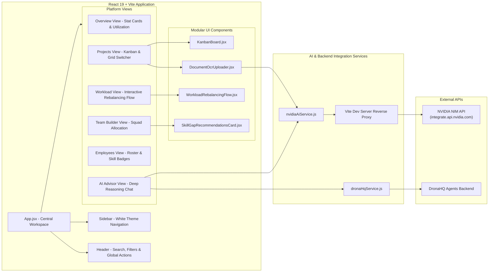

# 🏢 Workforce Intelligence Platform
### Smart Talent Planning, AI Team Builder & Workload Optimization

A high-performance enterprise workforce intelligence and talent planning application built with **React**, **Vite**, and **Vanilla CSS**, augmented with **NVIDIA NIM AI Models** for Document OCR extraction and multi-agent reasoning.

---

## 🌟 Executive Summary

In enterprise software delivery, project success relies on matching the right skill sets with available employee capacity without causing team burnout or budget overruns.

The **Workforce Intelligence Platform** solves this by unifying:
1. **Document Intelligence & OCR Auto-Fill**: Extract project scope, deliverables, budgets, and skill requirements directly from client quotation sheets and RFP drafts using NVIDIA NIM Vision LLMs (`meta/llama-3.2-11b-vision-instruct`).
2. **Interactive Project Lifecycle & Kanban Board**: Track initiatives across 4 lifecycle stages with native drag-and-drop, quick stage shifts, and grid/board toggle views.
3. **AI Team Builder & Skill Matching**: Dynamically calculate multi-factor fit scores (skills, experience, and current bandwidth) to assemble complementary squads.
4. **Workload Rebalancing Engine**: Multi-step interactive flow to identify overloaded engineers (>100% capacity) and safely shift tasks to underutilized talent.
5. **AI Advisor Copilot**: Deep reasoning multi-agent system powered by NVIDIA NIM to provide strategic verdicts on quotation profitability, capacity risks, and staffing feasibility.

---

## 🔄 End-to-End Workflow Flowchart

The following diagram illustrates how incoming project proposals transform into fully-staffed, balanced, and tracked development sprints:



---

## 🧠 System Architecture & Component Hierarchy



---

## 🚀 Key Feature Breakdown

### 1. Interactive Kanban Board & Lifecycle Tracker
- **Dual View Modes**: Switch between high-density **Kanban Board** and card-based **Grid View**.
- **4 Lifecycle Columns**:
  - `Backlog / Team Matching`: Unassigned projects awaiting squad matching.
  - `Active Delivery`: Active development sprint cycles.
  - `Testing & Review`: Security audits, QA cycles, and client acceptance.
  - `Delivered / Completed`: Shipped and closed contracts.
- **Interactivity**: Native HTML5 drag-and-drop with active drop-target highlighting plus quick `← Back` and `Next Stage →` action buttons.
- **Visual Metadata**: Real-time progress bars, budget badges (₹ INR), allocated member avatars, and priority chips.

### 2. Document Intelligence & OCR Auto-Fill (NVIDIA NIM)
- **Vision-Driven Extraction**: Powered by `meta/llama-3.2-11b-vision-instruct` via NVIDIA NIM.
- **Direct Document Support**: Upload contract PDFs, quotation image scans (JPEG/PNG), or text specs.
- **Multi-Layer Resilient Parser**:
  - *Layer 1*: Structured JSON extraction.
  - *Layer 2*: Markdown and tag-based regex (`TITLE:`, `BUDGET:`, `SKILLS:`).
  - *Layer 3*: Natural language domain heuristics for Indian Rupee formats (`₹31,86,000`), software deliverables (`Flutter`, `React`, `Payment Gateway`), and team sizing.
- **Live Form Sync**: Instantly populates the "Create Project" modal with one-click verification and manual override controls.

### 3. AI Team Builder & Skill Gap Recommendations
- **Algorithmic Squad Formation**: Evaluates 60+ organizational profiles to build optimal teams based on:
  $$\text{Match Score} = w_1 \cdot \text{Skill Overlap} + w_2 \cdot \text{Experience} + w_3 \cdot (100 - \text{Workload})$$
- **Subject Matter Expert (SME) Pinpointing**: Automatically designates tech leads and critical domain anchors.
- **Skill Gap Diagnosis**: Flags unfulfilled technologies (e.g., Kubernetes, Rust, Cloud Security) and generates recommended certification programs.

### 4. Workload Rebalancing Engine
- **Capacity Diagnostics**: Identifies employees operating above safe thresholds (>100% capacity) to prevent burnout and attrition.
- **4-Stage Allocation Simulator**:
  1. *Diagnostic Scan*: Pinpoints bottleneck engineers and delayed deliverables.
  2. *Interactive Task Shift*: Visual selector to reassign specific sprint milestones to available peers.
  3. *Impact Preview*: Demonstrates the resulting increase in Balance Index (e.g. 72% $\rightarrow$ 86%) and reduction in churn risk.
  4. *One-Click Dispatch*: Confirms allocations and dispatches notifications.

### 5. AI Advisor Copilot (Multi-Agent System)
- **Specialist Roles**:
  - *Project Analyst Agent*: Evaluates RFP feasibility and profit margins.
  - *Team Optimizer Agent*: Maximizes cross-functional squad synergy.
  - *Workforce Balancer Agent*: Advises on bandwidth preservation.
- **25-Second Deep Reasoning Countdown**: Displays progressive reasoning stages while analyzing organizational graphs.
- **Dual Backend**: Supports direct NVIDIA NIM API calls with Vite proxy fallback and graceful local heuristics.

---

## 🛠️ Tech Stack & Libraries

| Technology | Purpose |
| :--- | :--- |
| **React 19** | Modern UI components, hooks, and reactive state management |
| **Vite 6** | Ultra-fast build tool, local dev server & reverse proxy |
| **Vanilla CSS** | Tailored design system, sleek glassmorphism, responsive grid & light enterprise theme |
| **Lucide React** | Consistent enterprise icon set |
| **NVIDIA NIM API** | LLM & Vision inference (`meta/llama-3.2-11b-vision-instruct`) |
| **DronaHQ Agent API** | External agent execution and multi-agent coordination |

---

## 📂 Project Directory Structure

```text
d:/AMCattack/
├── src/
│   ├── components/
│   │   ├── modals/
│   │   │   ├── AddProjectModal.jsx        # Project creation modal with OCR sync
│   │   │   └── RebalanceModal.jsx         # Quick rebalance modal
│   │   ├── views/
│   │   │   ├── AiAdvisorView.jsx          # Deep reasoning AI chat canvas
│   │   │   ├── EmployeesView.jsx          # Employee directory & workload overview
│   │   │   ├── ProjectsView.jsx           # Projects hub & view switcher
│   │   │   ├── TeamBuilderView.jsx        # Team matching & SME selection
│   │   │   ├── WorkloadView.jsx           # Workload rebalancing dashboard
│   │   │   ├── SkillsTrainingView.jsx     # Skill gaps & training programs
│   │   │   └── ReportsView.jsx            # Enterprise capacity reports
│   │   ├── DocumentOcrUploader.jsx        # Document dropzone & OCR trigger
│   │   ├── KanbanBoard.jsx                # 4-stage interactive Kanban board
│   │   ├── WorkloadRebalancingFlow.jsx    # Multi-step allocation simulator
│   │   ├── Sidebar.jsx                    # Navigation sidebar
│   │   └── Header.jsx                     # Topbar controls & notifications
│   ├── data/
│   │   ├── employees.js                   # Employee dataset & skills inventory
│   │   └── projects.js                    # Initial project backlog & active contracts
│   ├── utils/
│   │   ├── nvidiaAiService.js             # NVIDIA NIM Vision & LLM client
│   │   ├── dronaHqService.js              # DronaHQ agent integration
│   │   └── workloadEngine.js              # Capacity calculation algorithms
│   ├── App.jsx                            # Root application component
│   ├── index.css                          # Complete design system & token definitions
│   └── main.jsx                           # Application entry point
├── .env.example                           # Sample environment configuration
├── vite.config.js                         # Vite config with API proxy rewrites
└── package.json                           # Dependencies & project scripts
```

---

## ⚙️ Getting Started & Installation

### 1. Prerequisites
- **Node.js** (v18.0.0 or higher recommended)
- **npm** (v9.0.0 or higher)

### 2. Clone the Repository
```bash
git clone https://github.com/Kartikey-varshney206/Hack-Attack-CD.git
cd Hack-Attack-CD
```

### 3. Switch to the `Harsha` Branch
```bash
git checkout Harsha
```

### 4. Install Dependencies
```bash
npm install
```

### 5. Configure Environment Variables
Copy `.env.example` to create your local `.env`:
```bash
cp .env.example .env
```
Add your NVIDIA API key (optional; a default developer sandbox key is provided as fallback):
```env
VITE_NVIDIA_API_KEY=your_nvidia_api_key_here
```

### 6. Run the Development Server
```bash
npm run dev
```
Open your browser and navigate to `http://localhost:3000` (or `http://localhost:3001` if port 3000 is occupied).

### 7. Production Build
```bash
npm run build
```
Verify the production bundle locally:
```bash
npm run preview
```

---

## 🛡️ License
Private and confidential enterprise software created for Hack-Attack. All rights reserved.