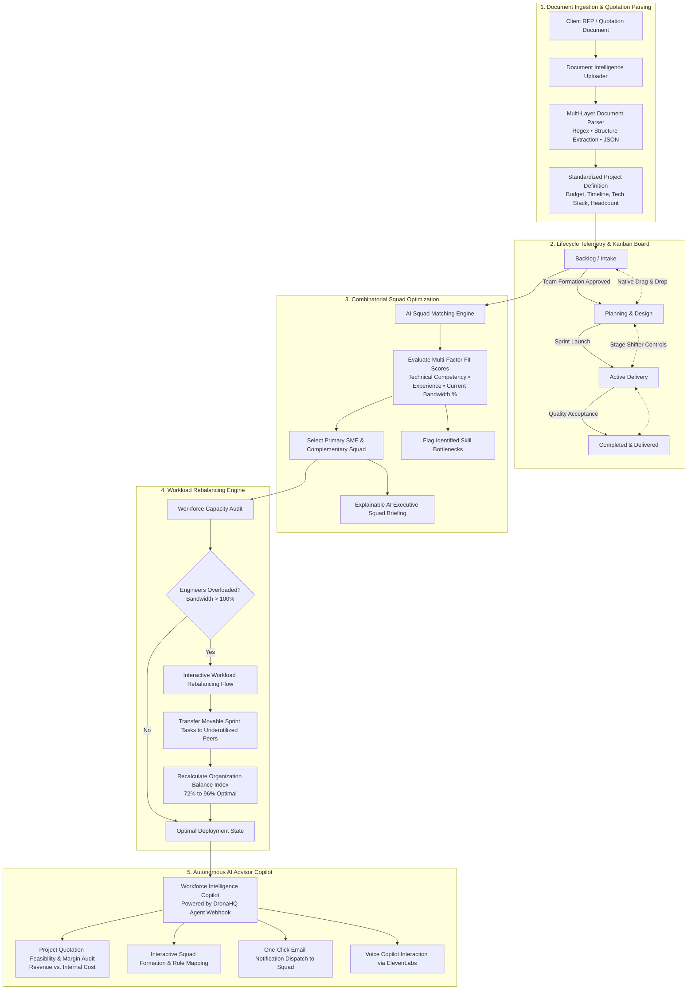
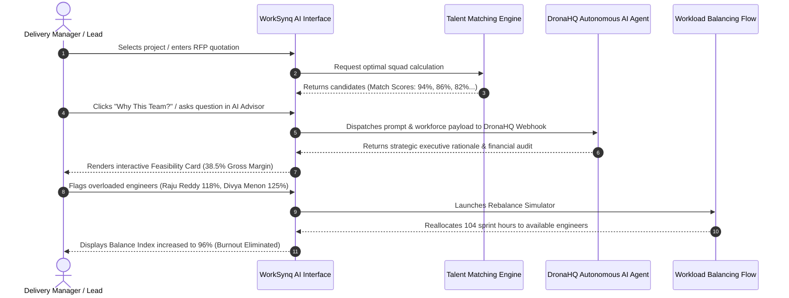

# ⚡ WorkSynq AI
### Autonomous Talent Planning, Squad Optimization & Workforce Intelligence Copilot

[](https://github.com/D-Harsha-vardhan/worksynq-AI)
[](https://github.com/D-Harsha-vardhan/worksynq-AI)
[](https://github.com/D-Harsha-vardhan/worksynq-AI)

A state-of-the-art enterprise workforce intelligence copilot and talent optimization platform built with **React 19** and **Vite 6**. WorkSynq AI unifies combinatorial team assembly, automated sprint workload rebalancing, document quotation auditing, Kanban lifecycle telemetry, and autonomous multi-agent reasoning.

---

## 🌟 Executive Overview

In modern engineering and technology consulting organizations, high-impact project delivery hinges on three critical operational factors:
1. **Precise Skill Alignment**: Ensuring required technologies (React, Flutter, Python, Kubernetes, REST API) are staffed by certified in-house engineers.
2. **Burnout Prevention & Capacity Safety**: Identifying overallocated engineers (>100% capacity) and smoothly shifting movable tasks to available peers.
3. **Commercial Feasibility & Margin Protection**: Auditing client quotations against estimated internal engineering sprint hours to guarantee profit margins before signing delivery contracts.

**WorkSynq AI** eliminates operational bottlenecks by providing an autonomous, explainable workforce operating system for delivery managers, engineering leads, and resource planning directors.

---

## 🔄 End-to-End System Workflow Flowchart



---

## 🧠 Multi-Agent Architecture & Decision Cycle



---

## 🚀 Key Platform Features

### 1. 🔍 Omnisearch & Real-Time Talent Discovery
- **Floating Omnisearch Bar**: Type any developer name, skill, role, or project to instantly view matched candidates with active load indicators (`Ctrl+K` shortcut).
- **Comprehensive Profile Inspector**: Inspect employee technical levels (1-5), total experience years, certifications, and project rosters.

### 2. ⚡ AI Team Builder & Combinatorial Matching
- **Multi-Factor Scoring**: Evaluates candidate fit based on verified technical level vs. project minimum level, domain seniority, and weekly hours remaining.
- **Explainable AI Rationale**: Detailed briefing breaking down skill synergies, delivery risks, and mentor-mentee pairing recommendations.
- **1-Click Candidate Swapping**: Swap any team member in real-time with automatically calculated alternative candidates.

### 3. ⚖️ Interactive Workload Rebalancing Flow
- **Capacity Risk Detection**: Identifies developers exceeding 100% capacity to prevent delivery crunch and burnout.
- **Movable Task Reallocation**: Reassigns sprint deliverables from overloaded leads to verified peers with available bandwidth.
- **Dynamic Balance Index**: Real-time gauge tracking organizational capacity balance from baseline (72%) to optimal (96%).

### 4. 📊 Project Lifecycle & Interactive Kanban Board
- **4 Lifecycle Columns**: `Backlog`, `Planning`, `In Progress`, and `Review / Delivered`.
- **Drag & Drop + Shift Controls**: Effortlessly transition cards across columns with smooth feedback and budget tracking.
- **Dual View Support**: Instantly toggle between Kanban Board and Card Grid views.

### 5. 🤖 Autonomous AI Advisor Copilot
- **DronaHQ Agent Webhook Integration**: Pure webhook agent execution without vendor lock-in.
- **Commercial Feasibility Audit**: Audits client quotations against estimated developer hours (e.g. ₹35 Lakh quote vs. ₹21.6 Lakh internal cost = 38.5% gross margin).
- **One-Click Team Dispatch**: Composes and dispatches project kickoff emails to all recommended squad members simultaneously.
- **ElevenLabs Conversational Voice**: Talk directly with the AI copilot using natural voice interaction.

### 6. 🎓 Skill Gap & Training Pathways
- **18 Mapped Technology Bottlenecks**: Critical deficits mapped to accredited online certification courses.
- **Mentorship Pairing**: Automatically assigns in-house senior architects as mentors for junior engineers.

### 7. 📈 Executive Reporting
- **PDF & CSV Export**: Export comprehensive talent utilization, staffing velocity, and project health snapshots.

---

## 📁 Repository Structure

```
worksynq-AI/
├── index.html                           # App entry point with Google Fonts & Voice Widget
├── vite.config.js                       # Vite build configuration with DronaHQ proxy
├── package.json                         # Project dependencies and npm scripts
├── .env.example                         # Example environment configuration (Safe & Clean)
├── .gitignore                           # Git ignore rules for credentials, keys, and build files
├── README.md                            # Comprehensive project documentation & flowcharts
└── src/
    ├── main.jsx                         # React 19 application bootstrapping
    ├── App.jsx                          # Main application layout, state orchestration, and tabs
    ├── index.css                        # Complete enterprise design system tokens and utilities
    ├── components/
    │   ├── Header.jsx                   # Omnisearch bar, live search dropdown, notifications
    │   ├── Sidebar.jsx                  # Navigation tabs, live copilot status indicator
    │   ├── StatCards.jsx                # Metric cards with micro-progress and trend analytics
    │   ├── ProjectTeamBuilder.jsx       # Centerpiece squad recommendation table
    │   ├── KanbanBoard.jsx              # Drag-and-drop 4-stage project lifecycle board
    │   ├── DocumentOcrUploader.jsx      # Document ingestion and project extraction
    │   ├── WorkloadRebalancingCard.jsx  # Overview workload distribution summary
    │   ├── WorkloadRebalancingFlow.jsx  # Multi-step interactive task reallocation flow
    │   ├── SkillGapRecommendationsCard.jsx # Skill gap recommendations & course enrollment
    │   └── modals/                      # Modals (Explainability, Swap, Enroll, Profile)
    ├── views/
    │   ├── AiAdvisorView.jsx            # Autonomous DronaHQ chat copilot & feasibility audit
    │   ├── ProjectsView.jsx             # Project management, Kanban board & OCR modal
    │   ├── TeamBuilderView.jsx          # Dedicated squad assembly view
    │   ├── EmployeesView.jsx            # Workforce directory (Grid & Table switcher)
    │   ├── WorkloadView.jsx             # Dedicated workload rebalancing hub
    │   ├── SkillsTrainingView.jsx       # Skill gap matrix & training courses
    │   ├── ReportsView.jsx              # Executive utilization reports with PDF/CSV export
    │   └── SettingsView.jsx             # Configuration & team preferences
    ├── utils/
    │   ├── dronaHqService.js            # DronaHQ Autonomous AI Agent webhook service
    │   ├── matchingEngine.js            # Combinatorial multi-factor talent matching algorithm
    │   ├── courseLinks.js               # Accredited course registry & direct URL resolver
    │   └── nvidiaAiService.js           # Forwarding bridge to DronaHQ autonomous agent
    └── data/
        ├── workforceData.js             # Initial 60 employees, active projects, skill gaps
        └── additionalWorkforceData.js   # 18 skill gap bottlenecks & training definitions
```

---

## 🛠️ Getting Started

### Prerequisites
- **Node.js**: v18.0.0 or higher
- **npm**: v9.0.0 or higher

### Installation

1. **Clone the repository**:
   ```bash
   git clone https://github.com/D-Harsha-vardhan/worksynq-AI.git
   cd worksynq-AI
   ```

2. **Install dependencies**:
   ```bash
   npm install
   ```

3. **Configure Environment Variables**:
   Copy `.env.example` to `.env`:
   ```bash
   cp .env.example .env
   ```
   Add your DronaHQ Agent webhook URL and API key (optional for local mock execution):
   ```env
   VITE_DRONAHQ_WEBHOOK_URL=https://agents-backend.dronahq.com/webhook/your-webhook-id
   VITE_DRONAHQ_API_KEY=your_api_key_here
   ```

4. **Start the local development server**:
   ```bash
   npm run dev
   ```
   Open your browser and navigate to `http://localhost:3000` (or the port indicated in your terminal).

5. **Build for Production**:
   ```bash
   npm run build
   ```

---

## 🔒 Security & Credential Management

- **Zero Credentials in Git**: All sensitive API keys, webhook URLs, and secrets are strictly excluded via `.gitignore`.
- **Environment Driven**: Production deployments read credentials exclusively from environment variables (`import.meta.env`).
- **Safe Fallbacks**: If external webhooks are unavailable or in draft state, WorkSynq AI continues operating seamlessly using deterministic internal domain algorithms without throwing unhandled exceptions.

---

## 👨‍💻 Author & Maintainer

- **Damarasinghu Harsha vardhan** ([@D-Harsha-vardhan](https://github.com/D-Harsha-vardhan))
  - GitHub: [https://github.com/D-Harsha-vardhan](https://github.com/D-Harsha-vardhan)
  - Project Repository: [https://github.com/D-Harsha-vardhan/worksynq-AI](https://github.com/D-Harsha-vardhan/worksynq-AI)

---

## 📄 License

This project is licensed under the MIT License — see the [LICENSE](LICENSE) file for details.